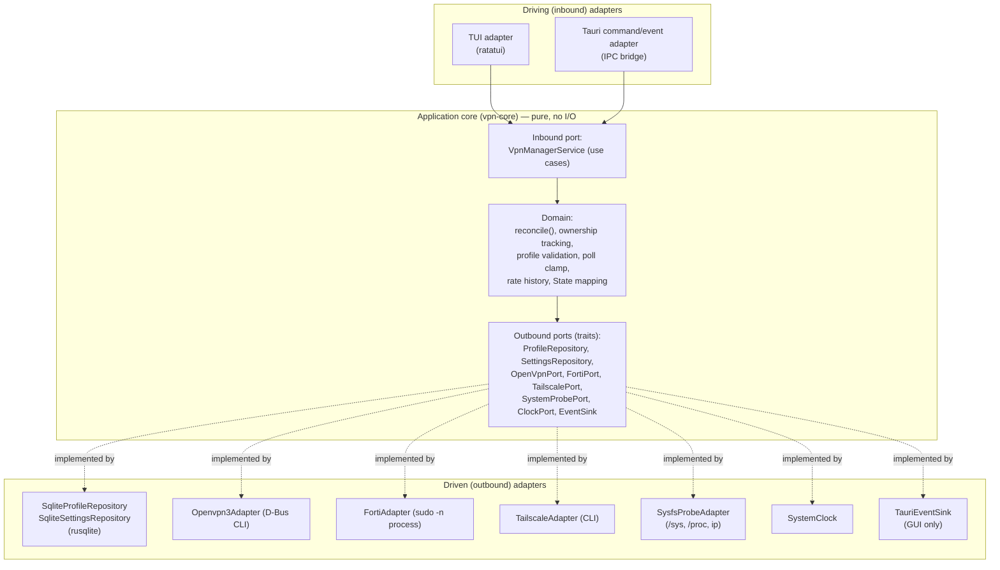
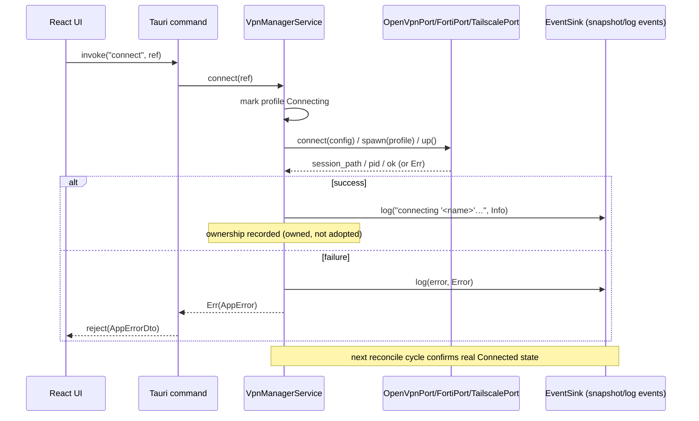
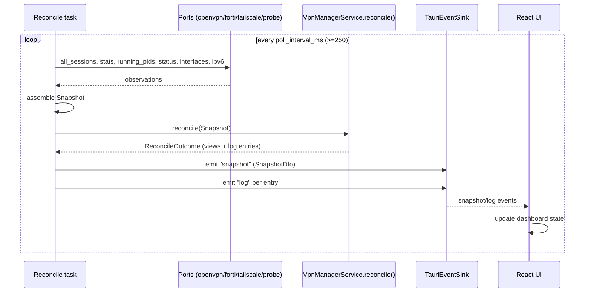
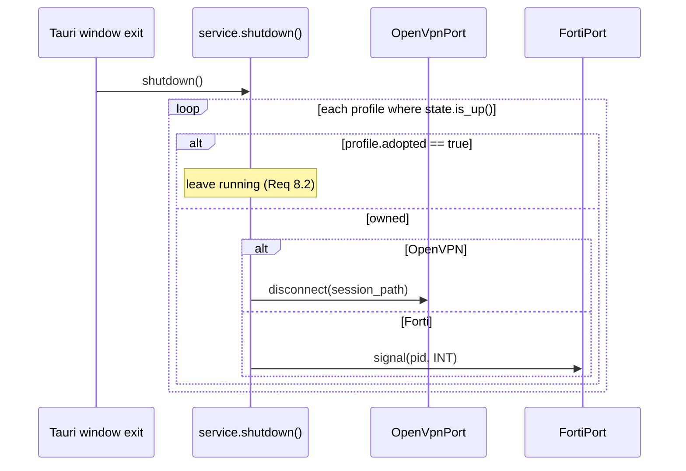
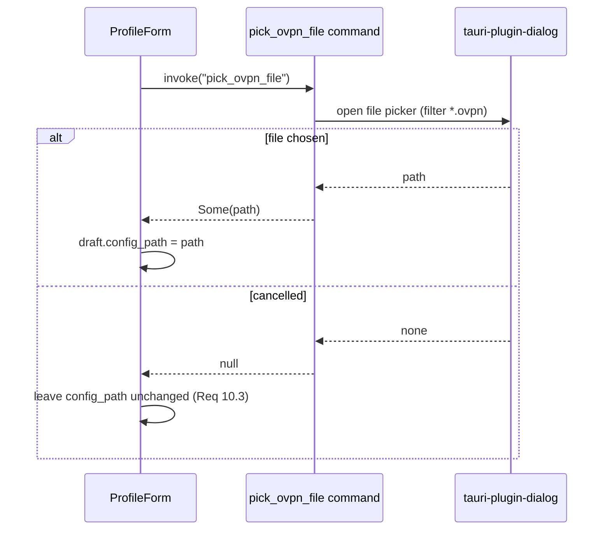

# Design Document

## Overview

This design ports the existing `vpn-tui` terminal VPN manager to a Tauri desktop
application (React + TypeScript frontend, Rust backend) while keeping the TUI
fully functional. The strategy is **extraction, not rewrite**: the VPN logic
that today lives inside the `vpn-tui` binary (database persistence, the three
VPN command wrappers, and the reconciliation engine) is lifted into a shared
library crate, `vpn-core`. Both the existing TUI and the new GUI become thin
*inbound adapters* that drive the same core.

The whole design is organized around **hexagonal architecture (ports and
adapters)**. The business rules — how profiles are validated, how real system
state is reconciled into per-profile status, which sessions are *owned* vs
*adopted*, how the poll interval is clamped — live in a pure application core
that knows nothing about Tauri, ratatui, D-Bus, SQLite, or `/proc`. Everything
that talks to the outside world (databases, subprocesses, the filesystem, the
webview) sits behind a **port** (a Rust trait) and is implemented by an
**adapter**.

### How the design maps to hexagonal architecture

- **Domain / application core** (`vpn-core::domain`, `vpn-core::app`): pure
  logic with no I/O. This is the reconciliation engine (`reconcile(Snapshot)`),
  session-ownership tracking (`adopted` vs owned), profile validation including
  the optional-name rule, poll-interval clamping, log-capacity clamping, the
  per-profile rate history (80 samples), and the mapping from raw observations
  to per-profile `State`. It depends only on outbound *port traits*, never on
  concrete adapters.

- **Driving (inbound) ports**: the application-service API that any UI calls —
  `VpnManagerService` (connect/disconnect single/all, profile CRUD, settings
  read/update, OpenVPN3 session management, IPv6 toggle, Tailscale control).
  These are the use cases.

- **Driven (outbound) ports**: traits the core depends on and that adapters
  implement — `ProfileRepository`, `SettingsRepository`, `OpenVpnPort`,
  `FortiPort`, `TailscalePort`, `SystemProbePort`, `ClockPort`, and an
  `EventSink` (for emitting log entries and snapshots).

- **Driving (inbound) adapters**: the **Tauri command/event adapter** (bridges
  IPC `invoke()` calls and events to the inbound ports) and the **existing TUI
  adapter** (ratatui). Both reuse the same `VpnManagerService`.

- **Driven (outbound) adapters**: `SqliteProfileRepository` +
  `SqliteSettingsRepository` (rusqlite), `Openvpn3Adapter` / `FortiAdapter` /
  `TailscaleAdapter` (wrapping today's command wrappers), `SysfsProbeAdapter`
  (`/sys/class/net`, `/proc`, `ip`), a `SystemClock`, and — for the GUI only —
  a `TauriEventSink` that forwards logs and snapshots to the webview.

### The hexagon



The dependency direction is the key invariant: adapters depend on the core, the
core depends only on its own port traits. This is what lets the TUI and the GUI
share one implementation (Requirement 1) and what makes the domain unit-testable
with fake adapters (Requirement 1.3 — no terminal-UI dependencies in the core).

## Architecture

### Cargo workspace structure

The repository becomes a Cargo workspace with three members. Extracting the
shared code into `vpn-core` is the **only** change to the existing TUI; its
behavior is preserved.

```
vpn-tui/                      (workspace root)
├── Cargo.toml                # [workspace] members = ["vpn-core","vpn-tui","vpn-gui"]
├── Cargo.lock
├── install.sh                # extended, still installs the TUI
│
├── vpn-core/                 # LIBRARY: domain + ports + outbound adapters
│   ├── Cargo.toml            # no ratatui, no tauri
│   └── src/
│       ├── lib.rs
│       ├── domain/           # pure types + rules (no I/O)
│       │   ├── mod.rs
│       │   ├── profile.rs    # Profile, Kind, display_name, validate_profile_name
│       │   ├── state.rs      # State, Stats, rate history, human_bytes/duration
│       │   ├── snapshot.rs   # Snapshot (domain-side observation)
│       │   └── reconcile.rs  # reconcile(): the ownership/adoption engine
│       ├── app/              # inbound port (application service)
│       │   ├── mod.rs
│       │   └── service.rs    # VpnManagerService use-case trait + impl
│       ├── ports/            # outbound port traits
│       │   ├── mod.rs
│       │   ├── repository.rs # ProfileRepository, SettingsRepository
│       │   ├── vpn.rs        # OpenVpnPort, FortiPort, TailscalePort
│       │   ├── probe.rs      # SystemProbePort
│       │   ├── clock.rs      # ClockPort
│       │   └── sink.rs       # EventSink
│       └── adapters/         # outbound adapters (the former wrappers)
│           ├── mod.rs
│           ├── sqlite.rs     # Sqlite{Profile,Settings}Repository (was db.rs)
│           ├── openvpn3.rs   # Openvpn3Adapter (was vpn/openvpn3.rs)
│           ├── fortivpn.rs   # FortiAdapter (was vpn/fortivpn.rs)
│           ├── tailscale.rs  # TailscaleAdapter (was vpn/tailscale.rs)
│           └── sysfs.rs      # SysfsProbeAdapter (was parts of vpn/mod.rs)
│
├── vpn-tui/                  # EXISTING BINARY, now an inbound adapter
│   ├── Cargo.toml            # depends on vpn-core; keeps ratatui
│   └── src/
│       ├── main.rs
│       ├── ui.rs             # ratatui rendering (unchanged)
│       ├── event.rs          # keyboard/tick threads (adapter-local)
│       └── app.rs            # TUI view-state; delegates logic to vpn-core
│
└── vpn-gui/                  # NEW Tauri binary = inbound adapter
    ├── Cargo.toml            # depends on vpn-core + tauri
    ├── tauri.conf.json
    ├── build.rs
    ├── src/
    │   ├── main.rs           # Tauri builder, manages AppState
    │   ├── commands.rs       # #[tauri::command] handlers → VpnManagerService
    │   ├── dto.rs            # serde DTOs crossing the IPC boundary
    │   ├── reconcile_task.rs # background poll loop → emits events
    │   └── sink.rs           # TauriEventSink (EventSink impl)
    └── ui/                   # React + TypeScript frontend
        ├── package.json
        ├── index.html
        └── src/
            ├── main.tsx
            ├── ipc.ts        # typed invoke() wrapper + event listeners
            ├── types.ts      # DTO type definitions (mirror of dto.rs)
            └── components/   # Dashboard, ProfileList, ProfileForm, ...
```

Module boundaries:

- `vpn-core` compiles without `ratatui` or `tauri` in its dependency tree
  (Requirement 1.3). Its public API is `VpnManagerService` + the port traits +
  the domain types.
- `vpn-tui` keeps `ratatui`, `tui-input`, `ratatui-explorer`. Its `app.rs`
  shrinks to view-state and key handling; the reconciliation and VPN operations
  are called through `vpn-core`.
- `vpn-gui` keeps `tauri` and its plugins; it never touches rusqlite, D-Bus, or
  `/proc` directly — only through `vpn-core` ports.

### Composition root (dependency injection)

Each binary wires concrete adapters into the core at startup. The core is
generic over its ports, so the TUI and GUI inject the same production adapters;
tests inject fakes.

```rust
// vpn-gui/src/main.rs (composition root)
let repo       = SqliteProfileRepository::open(Db::default_path())?;
let settings   = SqliteSettingsRepository::new(repo.conn());
let openvpn    = Openvpn3Adapter::new();
let forti      = FortiAdapter::new();
let tailscale  = TailscaleAdapter::new();
let probe      = SysfsProbeAdapter::new();
let clock      = SystemClock;
let sink        = TauriEventSink::new(app_handle.clone());

let service = VpnManagerService::new(
    repo, settings, openvpn, forti, tailscale, probe, clock, sink,
);
```

## Components and Interfaces

### Inbound port: `VpnManagerService`

The single application-service API the UIs call. Methods map one-to-one to the
Tauri commands and to the TUI's key actions.

```rust
pub trait VpnManager {
    // Connection control (Req 3.1)
    fn connect(&mut self, profile_id: ProfileRef) -> Result<(), AppError>;
    fn disconnect(&mut self, profile_id: ProfileRef) -> Result<(), AppError>;
    fn connect_all(&mut self) -> Result<(), AppError>;
    fn disconnect_all(&mut self) -> Result<(), AppError>;

    // Profile CRUD (Req 3.2, 9)
    fn list_profiles(&self) -> Vec<ProfileView>;
    fn create_openvpn(&mut self, draft: OpenVpnDraft) -> Result<i64, AppError>;
    fn update_openvpn(&mut self, id: i64, draft: OpenVpnDraft) -> Result<(), AppError>;
    fn delete_openvpn(&mut self, id: i64) -> Result<(), AppError>;
    fn create_forti(&mut self, draft: FortiDraft) -> Result<i64, AppError>;
    fn update_forti(&mut self, id: i64, draft: FortiDraft) -> Result<(), AppError>;
    fn delete_forti(&mut self, id: i64) -> Result<(), AppError>;

    // Settings (Req 3.3, 6, 16)
    fn settings(&self) -> General;
    fn update_settings(&mut self, patch: SettingsPatch) -> Result<(), AppError>;

    // OpenVPN3 session management (Req 12)
    fn list_sessions(&self) -> Vec<SessionView>;
    fn kill_session(&mut self, path: &str) -> Result<(), AppError>;
    fn kill_all_sessions(&mut self) -> Result<(), AppError>;

    // IPv6 (Req 13)
    fn set_ipv6_disabled(&mut self, disabled: bool) -> Result<(), AppError>;

    // Tailscale (Req 14)
    fn tailscale_up(&mut self) -> Result<(), AppError>;
    fn tailscale_down(&mut self) -> Result<(), AppError>;
    fn tailscale_set_exit_node(&mut self, ip: Option<String>) -> Result<(), AppError>;
    fn tailscale_set_routes(&mut self, routes: Vec<String>) -> Result<(), AppError>;

    // Reconciliation (Req 4, 6, 7, 8)
    fn reconcile(&mut self, snap: Snapshot) -> ReconcileOutcome;
    fn shutdown(&mut self); // close only owned sessions (Req 8)
}
```

`ProfileRef` identifies a managed row (`Kind` + stored id, or the synthetic
Tailscale row). `ReconcileOutcome` carries the updated per-profile views plus
any log entries the engine produced during reconciliation, so the inbound
adapter can forward them to its sink.

### Outbound ports (driven)

```rust
// ports/repository.rs — persistence ports (the Repository pattern)
pub trait ProfileRepository {
    fn openvpn_profiles(&self) -> Result<Vec<OpenVpnProfile>>;
    fn forti_profiles(&self) -> Result<Vec<FortiProfile>>;
    fn insert_openvpn(&self, name: Option<&str>, config: &Path) -> Result<i64>;
    fn update_openvpn(&self, id: i64, name: Option<&str>, config: &Path) -> Result<()>;
    fn delete_openvpn(&self, id: i64) -> Result<()>;
    fn insert_forti(&self, draft: &FortiProfileData) -> Result<i64>;
    fn update_forti(&self, id: i64, draft: &FortiProfileData) -> Result<()>;
    fn delete_forti(&self, id: i64) -> Result<()>;
}

pub trait SettingsRepository {
    fn general(&self) -> Result<General>;
    fn set_setting(&self, key: &str, value: &str) -> Result<()>;
}

// ports/vpn.rs — the three VPN technologies
pub trait OpenVpnPort {
    fn connect(&self, config: &Path) -> Result<String>;      // -> session path
    fn disconnect(&self, session_path: &str) -> Result<()>;
    fn all_sessions(&self) -> Result<Vec<Session>>;
    fn disconnect_all(&self, sessions: &[Session]) -> Result<()>;
    fn stats(&self, session_path: &str) -> Result<Stats>;
    fn available(&self) -> bool;
}

pub trait FortiPort {
    fn spawn(&self, idx: usize, profile: &FortiProfile, sink: &dyn EventSink) -> Result<u32>;
    fn signal(&self, pid: u32, sig: Signal) -> Result<String>;
    fn running_pids(&self) -> Vec<u32>;
    fn available(&self) -> bool;
}

pub trait TailscalePort {
    fn status(&self) -> Result<TailscaleStatus>;
    fn up(&self) -> Result<()>;
    fn down(&self) -> Result<()>;
    fn set_exit_node(&self, node: Option<&str>) -> Result<()>;
    fn set_advertise_routes(&self, routes: &[String]) -> Result<()>;
    fn available(&self) -> bool;
}

// ports/probe.rs — the system observation port
pub trait SystemProbePort {
    fn tunnel_interfaces(&self) -> Vec<Iface>;
    fn ipv6_disabled(&self) -> Option<bool>;
    fn run_script(&self, path: &Path) -> Result<()>; // privileged ipv6 scripts
}

// ports/clock.rs — so rate math and "since" are deterministic in tests
pub trait ClockPort {
    fn now(&self) -> Instant;
}

// ports/sink.rs — emit logs and snapshots back to whichever UI
pub trait EventSink: Send + Sync {
    fn log(&self, entry: LogEntry);
    fn snapshot(&self, view: SnapshotView);
}
```

The two repository traits are the **outbound persistence ports** of the
hexagon. `SqliteProfileRepository` / `SqliteSettingsRepository` are their only
production adapters and preserve the existing schema, the `chmod 600` on the DB
file, the `name`-nullable migration, the legacy `config.toml` one-time import,
and the IPv6-script-path upgrade. Nothing else in the system issues SQL.

### Repository design

Both repositories wrap a single `rusqlite::Connection` opened at
`~/.local/share/vpn-tui/vpn-tui.db` (overridable with `VPN_TUI_DB`). The adapter
is a direct port of today's `db.rs`:

- `open_at(path)` creates the parent dir, opens the connection, runs
  `init_schema`, `migrate_name_nullable`, applies `chmod 600`
  (`restrict_permissions`), and on a *new* file runs the legacy TOML migration
  (`find_legacy_toml` + `migrate_from_toml`). (Req 2.4, 16.3)
- `general()` reads the `settings` table and applies the same clamps as today:
  `poll_interval_ms` → `max(250)`, `log_capacity` → `max(100)`, defaults 2000 /
  2000. The poll-interval and log-capacity clamping is **also** enforced in the
  domain (see Correctness Properties) so it holds regardless of adapter. (Req
  6.4, 6.5, 15.4)
- Profile CRUD matches the existing signatures. The `name` column stays
  nullable so the optional-name rule is representable. (Req 9, 16.1, 16.2)
- Forti credentials are stored in the DB columns, never on a command line; the
  `FortiAdapter` writes them to a `chmod 600` temp file at connect time. (Req
  16.4)

The GUI shares the same file on disk, so TUI-created profiles appear unchanged
(Req 2.3, 2.5). Concurrent access is serialized through SQLite; the GUI opens
its own connection.

### Driving adapter: Tauri backend

`vpn-gui` holds the `VpnManagerService` behind a `tauri::State<Mutex<Service>>`.
Each `#[tauri::command]` locks the service, converts DTOs ↔ domain types, calls
the inbound port, and converts the `Result` into a serializable outcome.

### Driving adapter: TUI

`vpn-tui/src/app.rs` keeps only *view* concerns (selection, focus, form state,
log scrollback). All VPN actions and `reconcile()` are delegated to the shared
`VpnManagerService`. The TUI constructs an `EventSink` that pushes log lines
into its in-memory scrollback and triggers a redraw, mirroring today's
`Msg::Log` flow.

## Data Models

### Domain types (in `vpn-core`, pure)

Carried over from the current code, unchanged in meaning:

- `Kind { OpenVpn, Forti, Tailscale }`
- `State { Disconnected, Connecting, Connected, Disconnecting, Failed(String) }`
- `Stats { bytes_in: u64, bytes_out: u64 }`
- `OpenVpnProfile { id, name: Option<String>, config: PathBuf }`
- `FortiProfile { id, name: Option<String>, host, username, password,
  password_env, trusted_cert, extra_args }`
- `General { ipv6_disable_script, ipv6_enable_script, poll_interval_ms,
  log_capacity, ipv6_on_connect }`
- `Session { path, config_name, device, status }`
- `TailscaleStatus { backend_state, self_ips, exit_node_ip, advertise_routes,
  exit_node_candidates }`
- `Iface { name, addr, rx, tx }`
- `Profile` — the managed runtime row: `kind`, `name`, `state`, `since`,
  `session_path`, `pid`, `device`, `addr`, `stats`, `rate_in`/`rate_out`
  (capped at 80 samples), `adopted`, `placeholder`.
- `Snapshot { openvpn_available, fortivpn_available, sessions, stats,
  forti_pids, interfaces, ipv6_disabled, tailscale }` — the observed real state
  fed into `reconcile`.
- `LogEntry { timestamp, level: Level, profile_idx: Option<usize>, text }`

### DTOs (adapter layer, serde-serializable, cross the IPC boundary)

DTOs are defined in `vpn-gui/src/dto.rs` and mirrored in `ui/src/types.ts`.
They are *not* domain types: they exist only to cross IPC and are mapped to/from
domain types in the command handlers.

- `ProfileDto { ref: ProfileRefDto, kind, display_name, state, target, addr,
  bytes_in, bytes_out, rate_in, rate_out, adopted, placeholder }`
- `OpenVpnDraftDto { name: Option<String>, config_path }`
- `FortiDraftDto { name: Option<String>, host, port, username, password,
  password_env, trusted_cert, extra_args }`
- `SnapshotDto { profiles: Vec<ProfileDto>, ipv6_disabled: Option<bool>,
  tailscale: Option<TailscaleStatusDto>, openvpn_available, fortivpn_available }`
- `SessionDto { path, config_name, device, status, connected }`
- `TailscaleStatusDto { backend_state, running, self_ips, exit_node_ip,
  advertise_routes, exit_node_candidates: Vec<ExitNodeCandidateDto> }`
- `LogEntryDto { timestamp, level, profile_ref: Option<ProfileRefDto>, text }`
- `SettingsDto { poll_interval_ms, log_capacity, ipv6_disable_script,
  ipv6_enable_script, ipv6_on_connect }`
- `AppErrorDto { operation: String, message: String }`

### Domain ↔ DTO mapping

Mapping lives entirely in the Tauri adapter (`dto.rs`), one `From`/`into_dto`
per pair. The TUI never constructs DTOs — it reads domain types directly. This
keeps serde out of `vpn-core` and keeps the IPC contract an adapter concern.

| Domain | DTO | Notes |
|---|---|---|
| `Profile` | `ProfileDto` | `display_name` via `display_name(kind,name)`; rate series truncated to last N for the chart |
| `OpenVpnDraft` | `OpenVpnDraftDto` | `config_path` string ↔ `PathBuf` |
| `FortiProfile` | `FortiDraftDto` | password returned to UI only as "set/unset" flag, never the literal |
| `Snapshot`→`SnapshotView` | `SnapshotDto` | derived, read-only |
| `Session` | `SessionDto` | `connected` = `Session::is_connected()` |
| `TailscaleStatus` | `TailscaleStatusDto` | `running` = `is_running()` |
| `AppError` | `AppErrorDto` | `{operation, message}` (Req 3.6) |

## Backend (Tauri) design

### Command handlers

Every inbound use case is exposed as a `#[tauri::command]`. Each handler locks
the shared service, maps DTOs to domain types, invokes the port, and maps the
result back. The full list (Requirement 3):

| Tauri command | Inbound use case | Requirement |
|---|---|---|
| `connect(profile_ref)` | `connect` | 3.1 |
| `disconnect(profile_ref)` | `disconnect` | 3.1 |
| `connect_all()` | `connect_all` | 3.1 |
| `disconnect_all()` | `disconnect_all` | 3.1 |
| `list_profiles()` | `list_profiles` | 3.2, 9 |
| `create_openvpn(draft)` | `create_openvpn` | 3.2, 9.1 |
| `update_openvpn(id, draft)` | `update_openvpn` | 3.2, 9.1 |
| `delete_openvpn(id)` | `delete_openvpn` | 3.2, 9.1 |
| `create_forti(draft)` | `create_forti` | 3.2, 9.2 |
| `update_forti(id, draft)` | `update_forti` | 3.2, 9.2 |
| `delete_forti(id)` | `delete_forti` | 3.2, 9.2 |
| `get_settings()` | `settings` | 3.3, 16 |
| `update_settings(patch)` | `update_settings` | 3.3, 6, 16 |
| `list_sessions()` | `list_sessions` | 12.1 |
| `kill_session(path)` | `kill_session` | 12.2 |
| `kill_all_sessions()` | `kill_all_sessions` | 12.3 |
| `set_ipv6(disabled)` | `set_ipv6_disabled` | 13.1, 13.2 |
| `tailscale_up()` | `tailscale_up` | 14.2 |
| `tailscale_down()` | `tailscale_down` | 14.3 |
| `tailscale_set_exit_node(ip)` | `tailscale_set_exit_node` | 14.4 |
| `tailscale_set_routes(routes)` | `tailscale_set_routes` | 14.5 |
| `pick_ovpn_file()` | native dialog (plugin) | 10.1–10.3 |
| `needs_setup_wizard()` | reads repo emptiness | 11.1, 11.3 |

`pick_ovpn_file` uses the `tauri-plugin-dialog` file picker filtered to `.ovpn`.
It returns `Option<String>` — `Some(path)` on selection, `None` on cancel — and
the frontend decides whether to update the draft, so cancel leaves the config
path unchanged (Req 10.3). The file path is stored verbatim as the profile's
config path (Req 10.2); no file content is read into the webview.

### Background reconciliation task

On startup `vpn-gui` spawns an async task that mirrors the TUI's poll thread:

1. Read `General::poll_interval_ms` (already clamped to ≥ 250).
2. Build a `Snapshot` by calling the outbound ports: `OpenVpnPort::all_sessions`
   + `stats`, `FortiPort::running_pids`, `TailscalePort::status`,
   `SystemProbePort::tunnel_interfaces` + `ipv6_disabled`, plus availability
   flags. This is the port-based equivalent of today's `collect_snapshot()`
   (Req 6.1, 6.2).
3. Lock the service and call `reconcile(snapshot)` — the pure engine adopts
   external sessions, closes nothing, updates per-profile `State`, derives
   rates, and returns a `ReconcileOutcome`.
4. Emit a `snapshot` Tauri event with the `SnapshotDto`, and a `log` event for
   each `LogEntry` the engine produced (Req 4.2, 15.2).
5. Sleep `poll_interval_ms` and repeat.

The reconciliation reflects observed state, never optimistic prediction (Req
6.3). On app exit, a Tauri window `CloseRequested`/exit handler calls
`service.shutdown()`, which closes only owned sessions (Req 8).

### Tauri events

- `snapshot` → `SnapshotDto`, emitted every poll cycle (Req 4.2).
- `log` → `LogEntryDto`, emitted whenever the backend records a log entry (Req
  15.2). The backend bounds its own retained log buffer to `log_capacity`,
  discarding the oldest first (Req 15.3, 15.4).

## Frontend (React + TypeScript) design

### Component tree

```
App
├── SetupWizard                 (shown only when needs_setup_wizard() is true)
├── Dashboard                   (default view)
│   ├── ProfileList             (one row per managed VPN; live state + rates)
│   │   └── ProfileRow          (connect/disconnect buttons, sparkline)
│   ├── TailscalePanel          (status, up/down, exit-node, routes)
│   ├── Openvpn3SessionsManager (list all live sessions, kill one / kill all)
│   └── LogPanel                (live, capped scrollback)
├── ProfileForm                 (modal: create/edit OpenVPN3 or Forti)
└── SettingsForm                (modal: poll interval, log capacity, ipv6 scripts, ipv6_on_connect)
```

- **Dashboard** subscribes to `snapshot` events and renders the current
  per-profile state, cumulative counters, and instantaneous rate (Req 4.3).
- **ProfileForm** drives OpenVPN3/Forti CRUD and uses the native dialog for the
  `.ovpn` path. It enforces the optional-name rule client-side for immediate
  feedback, but the backend is the source of truth (validation also runs in the
  domain).
- **SetupWizard** appears when the DB has no profiles and no settings (Req 11),
  collects initial profiles/settings, and persists them via the CRUD/settings
  commands.
- **Openvpn3SessionsManager** lists every live session from `list_sessions()`,
  including sessions with no stored profile (Req 12.1), with kill-one and
  kill-all actions.
- **LogPanel** appends `log` events and trims to `log_capacity`.

### Typed IPC client

`ui/src/ipc.ts` wraps `@tauri-apps/api`'s `invoke` with one typed function per
command, and `listen` for the two events. All types come from `ui/src/types.ts`
which mirrors `dto.rs`.

```ts
import { invoke } from "@tauri-apps/api/core";
import { listen } from "@tauri-apps/api/event";

export const api = {
  connect: (ref: ProfileRef) => invoke<void>("connect", { profileRef: ref }),
  disconnect: (ref: ProfileRef) => invoke<void>("disconnect", { profileRef: ref }),
  listProfiles: () => invoke<ProfileDto[]>("list_profiles"),
  createOpenvpn: (d: OpenVpnDraftDto) => invoke<number>("create_openvpn", { draft: d }),
  getSettings: () => invoke<SettingsDto>("get_settings"),
  updateSettings: (p: Partial<SettingsDto>) => invoke<void>("update_settings", { patch: p }),
  pickOvpnFile: () => invoke<string | null>("pick_ovpn_file"),
  tailscaleSetExitNode: (ip: string | null) =>
    invoke<void>("tailscale_set_exit_node", { ip }),
  // ...one per command
};

export function onSnapshot(cb: (s: SnapshotDto) => void) {
  return listen<SnapshotDto>("snapshot", (e) => cb(e.payload));
}
export function onLog(cb: (l: LogEntryDto) => void) {
  return listen<LogEntryDto>("log", (e) => cb(e.payload));
}
```

Each `invoke` returns a rejected promise carrying an `AppErrorDto` when the
command fails; the UI surfaces `message` as a toast and the backend has already
logged it.

### State management

A lightweight store (React context + `useReducer`, or Zustand) holds:
`profiles`, `logs` (ring buffer capped at `log_capacity`), `tailscale`,
`sessions`, `settings`, `ipv6Disabled`, and `needsSetup`. The `snapshot` and
`log` listeners dispatch into this store on mount; components read derived
slices. Commands are fire-and-forget — the next `snapshot` event is what updates
displayed state, matching the reconcile-driven model (no optimistic UI).

### Native file dialog for `.ovpn`

The ProfileForm "Browse…" button calls `api.pickOvpnFile()`, which invokes the
backend command backed by `tauri-plugin-dialog` with an `.ovpn` filter. A
returned path is written into the draft's `config_path`; a `null` (cancel)
leaves the field as-is (Req 10).

## Sequence / flow descriptions

### Connect a profile



### Periodic reconciliation + snapshot event



### Adopt an external session

```mermaid
sequenceDiagram
    participant SVC as reconcile()
    participant P as Profile row

    Note over SVC: Snapshot shows an openvpn3 session matching a profile config,<br/>but profile.session_path is None (we never started it)
    SVC->>P: session_path = session.path; device = session.device
    SVC->>P: adopted = true; state = Connected
    SVC->>SVC: log("'<name>': existing session adopted", Info)
    Note over SVC: same for a Forti PID in forti_pids not in our managed set
```

### Close only owned sessions on exit



### Pick an `.ovpn` file



## Error Handling

### Across the IPC boundary

Every command returns `Result<T, AppErrorDto>`. On the Rust side, `AppError`
carries the failing `operation` and a human-readable `message`; the Tauri
command maps it to `AppErrorDto` so `invoke()` rejects with a structured object
(Req 3.6). The frontend shows `message` as a toast; the backend has already
recorded an `Error`-level `LogEntry` for the same failure, so the log and the
toast stay consistent.

### Privileged operations (`sudo -n`) and missing NOPASSWD

All privileged operations run with `sudo -n` (never interactive), preserving the
TUI guarantee that no password prompt appears mid-connection (Req 5.1, 5.2).

- **Forti**: the `FortiAdapter` keeps the layered `signal` strategy
  (`sudo pkill -x` → `sudo kill` → `kill`). If every attempt reports a
  "password is required" style failure, the adapter returns an error that names
  the fix ("run `sudo ./install.sh`") and the service records an `Error`-level
  log identifying the denied operation (Req 5.3).
- **IPv6 scripts**: run via `SystemProbePort::run_script` against the fixed
  `root:root` paths in `/usr/local/libexec/vpn/`; the sudoers rule targets those
  exact paths. A denial produces an `Error`-level log.
- **Tailscale**: `TailscaleAdapter` keeps the operator-mode-first strategy —
  run the plain command, and only if it fails with a privilege error retry with
  `sudo -n`; when both fail, the error names the one-time fix
  `sudo tailscale set --operator=<user>` (preserved from the TUI).

### Missing VPN tools (graceful degradation)

Each port exposes `available()`. When a tool is absent from `PATH`, the snapshot
marks it unavailable, the backend disables the dependent operations, and records
a `Warn`-level log naming the missing tool (Req 18.2); operations for the
present tools keep working (Req 18.3).

## Correctness Properties

*A property is a characteristic or behavior that should hold true across all
valid executions of a system — essentially, a formal statement about what the
system should do. Properties serve as the bridge between human-readable
specifications and machine-verifiable correctness guarantees.*

These properties target the pure `vpn-core` domain (reconciliation, ownership,
validation, clamping, the log ring buffer). They are exercised against *fake*
adapters (in-memory `ProfileRepository`, fake VPN ports, a controllable clock),
so no real D-Bus, sudo, or filesystem is involved.

### Property 1: Shutdown closes exactly the owned, up sessions and leaves adopted ones

*For any* set of managed profiles in arbitrary states and ownership, calling
`shutdown()` invokes the disconnect/signal port for every profile that is both
up and owned (`adopted == false`), and for no profile that is adopted
(`adopted == true`) or not up.

**Validates: Requirements 8.1, 8.2**

### Property 2: External sessions are adopted

*For any* `Snapshot` containing an OpenVPN3 session matching a profile whose
`session_path` is `None`, or a Forti PID present in `forti_pids` not in the set
of managed PIDs, after `reconcile(snapshot)` the corresponding profile is
`Connected` with `adopted == true`.

**Validates: Requirements 7.1**

### Property 3: Ownership is never silently flipped for an owned session

*For any* profile connected through `connect()` (recording an owned session),
reconciling with a `Snapshot` that still contains that same session leaves
`adopted == false`; a profile only becomes `adopted` when its connection is
first observed from the `Snapshot` rather than created by `connect()`.

**Validates: Requirements 7.3**

### Property 4: Reconcile reflects observed state, not optimistic state

*For any* profile currently marked `Connected` with a known `session_path` (or
`pid`), if the `Snapshot` no longer contains that session (or PID), after
`reconcile(snapshot)` the profile is `Disconnected` and its link fields are
reset.

**Validates: Requirements 6.3**

### Property 5: Poll interval is clamped to the floor

*For any* `u64` value `n` written to `poll_interval_ms`, the effective interval
read back is `max(n, 250)`; in particular it is always `>= 250`, and equals `n`
whenever `n >= 250`.

**Validates: Requirements 6.4**

### Property 6: Optional-name rule

*For any* candidate name and count of other profiles of the same kind:
`validate_profile_name(others, name)` returns `Ok(Some(trimmed))` when the name
is non-empty, `Ok(None)` when the name is empty/whitespace and `others == 0`,
and `Err` when the name is empty/whitespace and `others >= 1`.

**Validates: Requirements 9.5, 9.6**

### Property 7: Profile persistence round-trip

*For any* valid OpenVPN3 or Forti profile draft, inserting it through the
`ProfileRepository` and then listing profiles returns a profile whose stored
fields equal the draft's fields (name, config/host/username/credentials/
trusted-cert/extra-args).

**Validates: Requirements 9.1, 9.2, 9.3, 9.4, 16.1**

### Property 8: Settings persistence round-trip with clamping

*For any* settings patch, writing it through the `SettingsRepository` and
reading `general()` back yields the written values, with `poll_interval_ms`
clamped to `>= 250` and `log_capacity` clamped to `>= 100`.

**Validates: Requirements 16.1, 16.2**

### Property 9: Setup-wizard predicate

*For any* database state, `needs_setup_wizard()` is `true` if and only if there
are no stored profiles **and** no stored settings.

**Validates: Requirements 11.1, 11.3**

### Property 10: Session listing is unfiltered

*For any* set of live sessions reported by the `OpenVpnPort`, `list_sessions()`
returns exactly that set (same membership and count), including sessions not
associated with any stored profile.

**Validates: Requirements 12.1**

### Property 11: Kill-all terminates every listed session

*For any* set of live sessions, `kill_all_sessions()` invokes disconnect on each
session's path exactly once, and attempts the remaining sessions even if an
individual disconnect fails.

**Validates: Requirements 12.3**

### Property 12: IPv6-on-connect side effect is conditional

*For any* connect operation, the configured IPv6 disable script is run through
`SystemProbePort::run_script` exactly once when `ipv6_on_connect` is enabled,
and is not run when it is disabled.

**Validates: Requirements 13.3**

### Property 13: Log buffer is a bounded most-recent ring

*For any* capacity `c >= 1` and any sequence of log pushes, the retained buffer
never exceeds `c` entries and contains exactly the most recently pushed entries
(the oldest are discarded first).

**Validates: Requirements 15.3, 15.4**

### Property 14: Missing tools disable only their own operations

*For any* availability vector over the three VPN tools, the set of enabled
operations equals the operations whose tool is available, operations for present
tools remain enabled, and a `Warn`-level log entry is produced naming each
missing tool.

**Validates: Requirements 18.2, 18.3**

### Property 15: Privileged-denial produces an identifying error log

*For any* privileged operation driven against a port that returns a
privilege-denied (missing-NOPASSWD) error, the service records exactly one
`Error`-level log entry identifying the denied operation.

**Validates: Requirements 5.3**

## Testing Strategy

### Dual approach

- **Property-based tests** verify the universal domain properties above across
  randomized inputs. They run against fake adapters so they stay pure and fast.
- **Unit / example tests** cover concrete scenarios, edge cases, and the
  adapter-specific behaviors that are not universal (defaults, cancel-leaves-
  unchanged, credential-not-on-argv, legacy migration idempotence).
- **Integration tests** cover wiring that does not vary with input (probe
  sources feeding the snapshot, the dialog plugin, event emission).

### Property-based testing

PBT is appropriate here because the core is pure input→output logic
(reconciliation, validation, clamping, ring buffer) with large input spaces.

- Library: **`proptest`** for Rust. The domain core is tested with it; property
  tests are not hand-rolled.
- Each of Properties 1–15 is implemented as a **single** `proptest` test.
- Each property test runs a **minimum of 100 iterations** (proptest's default
  `cases` is 256; configure `#![proptest_config(ProptestConfig::with_cases(100))]`
  or higher).
- Each property test carries a comment tag referencing its design property:
  `// Feature: tauri-vpn-gui, Property 1: Shutdown closes exactly the owned, up sessions and leaves adopted ones`
- Generators produce: random `Profile` collections with mixed `Kind`, `State`,
  and ownership; random `Snapshot`s (session lists, PIDs, interfaces, tailscale
  status); random names (including whitespace-only); random `u64` intervals and
  capacities; random session lists; random tool-availability vectors.
- Fakes: `InMemoryProfileRepository`, `InMemorySettingsRepository`,
  `FakeOpenVpnPort` / `FakeFortiPort` / `FakeTailscalePort` (record calls, return
  scripted results including privilege-denied), `FakeProbe`, `FixedClock`,
  `RecordingSink`.

### Preserved core tests

The existing module tests move with their code into `vpn-core` and must keep
passing: `db.rs` tests (migration, CRUD, optional-name, schema upgrade, IPv6
path upgrade), `openvpn3.rs` parsing tests, `fortivpn.rs` host/port + classify
tests, `tailscale.rs` status/prefs parsing tests, and the `app.rs`
reconciliation/validation tests. This guards Requirement 1 (single shared
implementation) and 2.2 (TUI stays working).

### GUI integration considerations

- The React UI is exercised with component tests (snapshot/log event handling,
  ProfileForm validation, SetupWizard gating). React rendering uses example and
  snapshot tests, not PBT.
- A thin end-to-end smoke test launches the Tauri app, verifies the `snapshot`
  event arrives and the dashboard renders, and that `pick_ovpn_file` returns a
  path. These are low-iteration integration tests, not properties.
- Command handlers get example tests driving the service with fakes to confirm
  DTO mapping and error propagation (`AppErrorDto`).

## Packaging and Distribution

### Tauri bundle

`vpn-gui` is bundled with Tauri's packager targeting Linux: **AppImage** and
**`.deb`** (Req 17.1), configured in `tauri.conf.json` (`bundle.targets =
["appimage", "deb"]`). The bundle ships a desktop entry
(`vpn-gui.desktop`, `Categories=Network;System;`) that launches the GUI
directly (no terminal), giving a normal application-menu launcher (Req 17.2).
The `.deb` declares runtime recommendations for `openvpn3`, `openfortivpn`, and
`tailscale` (as `Recommends`, not hard `Depends`, so graceful degradation per
Req 18 still applies).

### Coexistence with the existing TUI

The GUI uses a distinct binary name (`vpn-gui`) and distinct desktop entry
(`vpn-gui.desktop`), leaving the TUI's `/usr/local/bin/vpn` and
`vpn.desktop` untouched (Req 17.4, 2.2). Both read the same database at
`~/.local/share/vpn-tui/vpn-tui.db`.

### Permissions model (same as the TUI)

The GUI reuses the exact permissions the TUI already relies on (Req 17.3):

- **NOPASSWD sudoers rules** in `/etc/sudoers.d/vpn-tui` for `openfortivpn`,
  the bounded `pkill -INT/-TERM/-KILL -x openfortivpn` rules, and the fixed
  IPv6 scripts. These are user-scoped and binary-agnostic, so they already
  cover the GUI — no new rule is needed because the privileged programs
  (`openfortivpn`, `pkill`, the IPv6 scripts) are the same.
- **`root:root` IPv6 scripts** at `/usr/local/libexec/vpn/ipv6-{disable,enable}.sh`.
  The GUI invokes them by their fixed absolute paths; they are never read from
  the database or any user-writable location (preventing a NOPASSWD-plus-
  writable-file privilege escalation).
- **Tailscale operator mode** (`sudo tailscale set --operator=<user>`), so
  `tailscale up/down/set` run without sudo; the adapter keeps the `sudo -n`
  fallback and the one-time-fix guidance.

### Installer integration

`install.sh` is extended to optionally build and install the GUI alongside the
TUI: add the Tauri system prerequisites (webkit2gtk, libayatana-appindicator,
and the JS toolchain to build the frontend), build `vpn-gui`, and install its
bundle + `vpn-gui.desktop`. The existing TUI install path, sudoers rules,
IPv6 scripts, and Tailscale operator configuration are unchanged and reused by
the GUI. Target platform remains Linux with systemd (Req 18.1).
